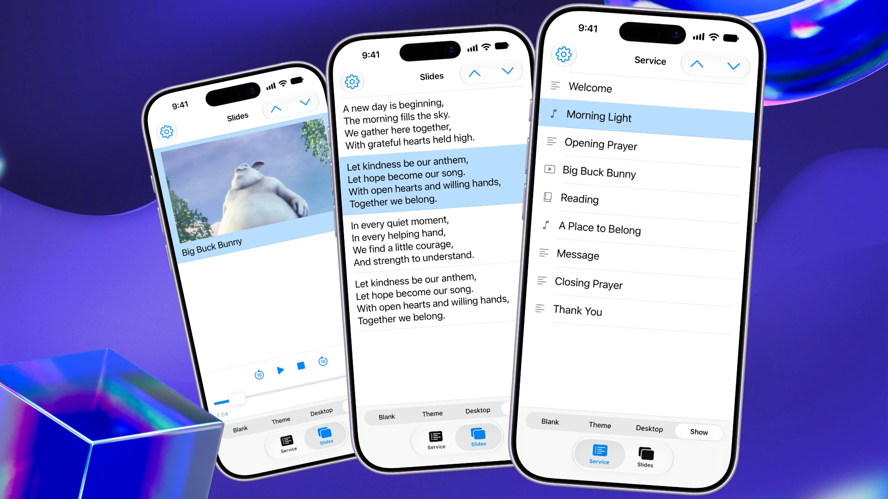
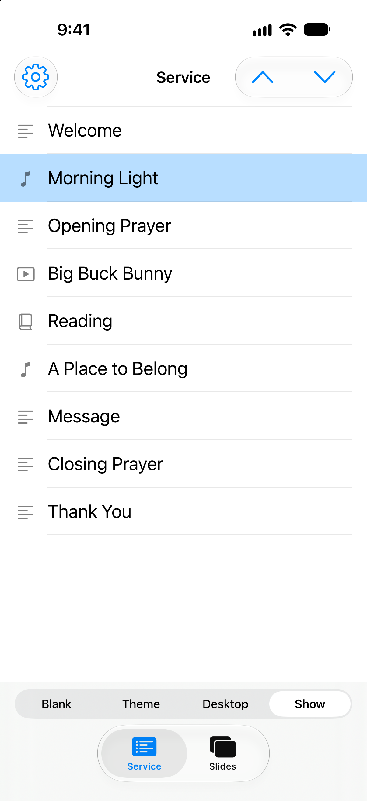
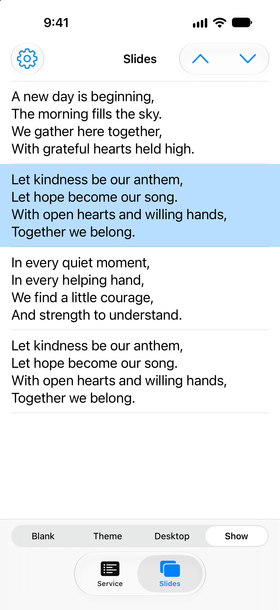
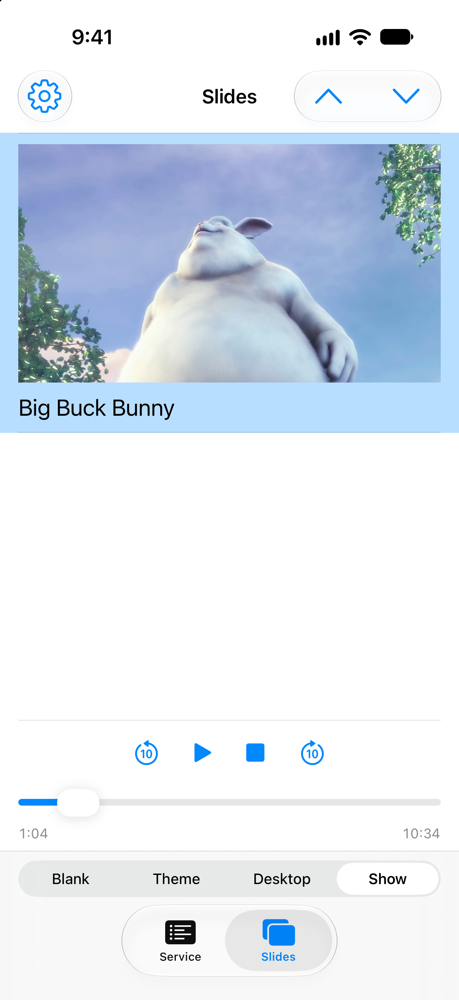
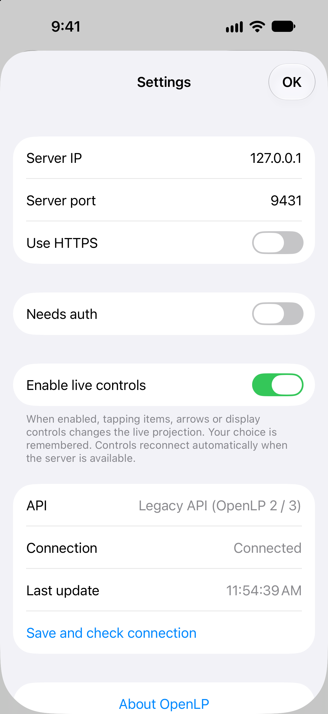

# OpenLP Swift Remote



A small, native iPhone remote for [OpenLP](https://openlp.org), built with SwiftUI. Browse the service, select slides, and control the display without installing OpenLP’s web remote files.

This is an independent project, not an official OpenLP release.

## Screenshots

Screenshots use fictional demo service content and original sample lyrics. The banner and video screenshot show a simulated paused playback state with a frame from *Big Buck Bunny* — © 2008 Blender Foundation / www.bigbuckbunny.org, [CC BY 3.0](https://creativecommons.org/licenses/by/3.0/).

<table>
  <tr>
    <td align="center"><strong>Service</strong><br></td>
    <td align="center"><strong>Slides</strong><br></td>
  </tr>
  <tr>
    <td align="center"><strong>Video controls</strong><br></td>
    <td align="center"><strong>Settings</strong><br></td>
  </tr>
</table>

## Features

- Native Service and Slides tabs, plus connection settings.
- Pale blue for a requested selection; stronger blue for the server-confirmed live selection.
- Single-slide service items stay on Service. Multi-slide items open Slides after confirmation.
- Previous/next controls and Blank, Theme, Desktop, and Show modes.
- Image previews and video stills when supported by the OpenLP server.
- Play/pause, stop, ten-second skips, and a native timeline for live media on the patched server.
- HTTP or HTTPS connections and optional Basic authentication.
- Live controls default to enabled. Your manual setting is remembered across launches, backgrounding, and reconnects. Commands remain unavailable while disconnected.
- Pull to refresh and automatic foreground refresh every two seconds.

## Build and connect

Requires macOS, Xcode with an iOS SDK, and iOS 17 or later. There are no third-party app dependencies.

1. Open `OpenLPRemote.xcodeproj` in Xcode and select the **OpenLPRemote** scheme.
2. Choose an iPhone simulator, or choose your development team and a unique bundle identifier to run on your iPhone.
3. Build and run. For a physical phone, enable Developer Mode and allow Local Network access when prompted.
4. In the app’s Settings, enter the OpenLP computer’s IP address or hostname and remote port (usually `4316`). Both devices must be able to reach the same network.
5. Live controls are enabled by default. Turn them off in Settings when you only want to browse.

The checked-in Xcode project is ready to open. To regenerate it after changing `project.yml`, run `xcodegen generate` with [XcodeGen](https://github.com/yonaskolb/XcodeGen).

## Offline demo

Open Settings → **Try Demo** to explore a bundled sample service without an OpenLP server. Song and image selection, display modes, and simulated video playback controls work locally. The demo sends no server requests and preserves your saved connection settings. Choose **Settings → Exit Demo** to return to your server. Video playback uses a still preview and simulated timeline.

## Demo screenshots

Run the included local API on your Mac:

```sh
python3 scripts/demo_server.py
```

For testing on a physical phone, run `python3 scripts/demo_server.py --host 0.0.0.0` and connect to your Mac’s LAN address on port `9431`.

In the iPhone simulator, connect to `127.0.0.1`, port `9431`, with HTTPS and authentication off. This demo never contacts a real OpenLP server. Its content is fictional and can be used for screenshots.

## Compatibility and limitations

The app detects the available API: legacy `/api` for OpenLP 2.x/3.x, with automatic fallback to `/api/v2` when legacy endpoints are absent. The adapters were checked against OpenLP 2.4.6, 3.1.7, and upstream v2 source. Compatibility checks exercise 2.4-style responses and a v2-only proxy against the local OpenLP instance; this is not a claim of testing every released desktop version.

Missing optional titles, plugin types, thumbnails, or fork-specific playback metadata do not prevent connection. Legacy authentication uses Basic auth; v2 uses the server login token. Missing legacy poll endpoints leave display buttons available without falsely highlighting a confirmed display mode. The detected API is shown in Settings. Native media controls require the fork’s extension and are omitted on stock servers.

The OpenLP API must be reachable even when its web interface is unavailable. Image previews depend on the server’s thumbnail endpoints; unavailable thumbnails are silently omitted. The companion OpenLP fork change on `codex/remote-media-previews` adds authenticated previews for the current live item at `/api/controller/live/thumbnail/<item-id>/<slide-index>`. Run that patched OpenLP source and enable thumbnails in its remote/API settings. Local video files require FFmpeg on the OpenLP computer; previews are still frames from the configured start time, not streaming playback. Streaming URLs and optical media are excluded from thumbnails and seeking. Playback controls require the companion media-control API patch; older servers simply omit the controls. Commands target a specific service item and execute on the OpenLP GUI thread. The app does not include search, alerts, or service editing.

Commands are serialized: additional taps are ignored while a command is awaiting confirmation, without dimming the controls. Confirmation times out after eight seconds and prompts you to check the projection before retrying. Passwords are kept only for the current app session. Basic authentication over HTTP is not encrypted; use HTTPS on networks where credentials need protection.

## Verification

Simulator and signed-device builds were completed. Manual simulator checks against a separate local server covered delayed service/slide confirmation, distinct pending/live highlights, and navigation for single- versus multi-slide items. Read-only checks covered a real server’s service list and live slide data. Live-control checks were performed against the local demo, not a running service. Image and video previews were visually verified in the simulator against the patched Python API with isolated demo media. Server regression checks cover real image/video decoding, authentication, stale item URLs, disabled thumbnails, and missing files.

## License and attribution

GPL-3.0-or-later. See [LICENSE](LICENSE) and [NOTICE.md](NOTICE.md).

The app icon uses OpenLP’s official logo artwork. The OpenLP name and logo identify the compatible software; they do not imply endorsement.
